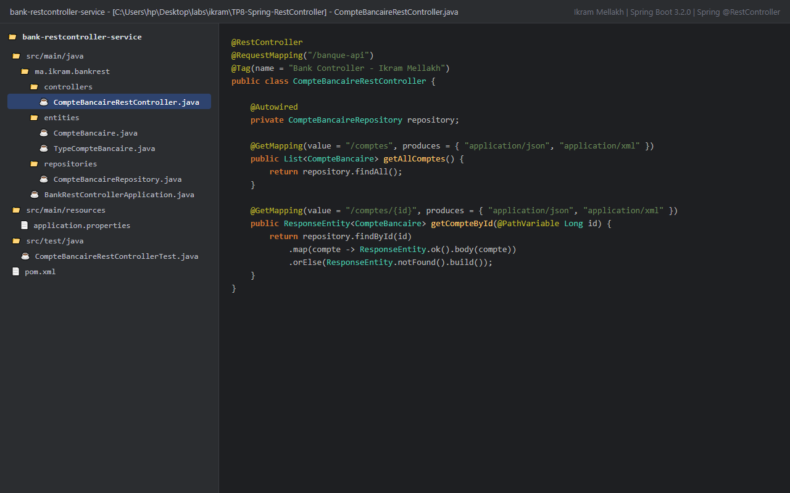
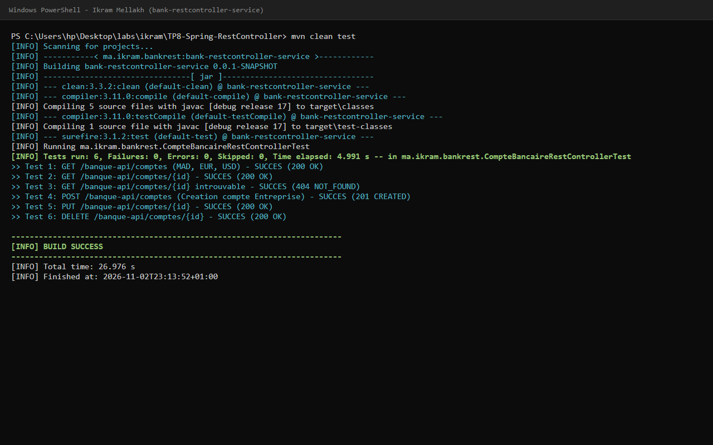
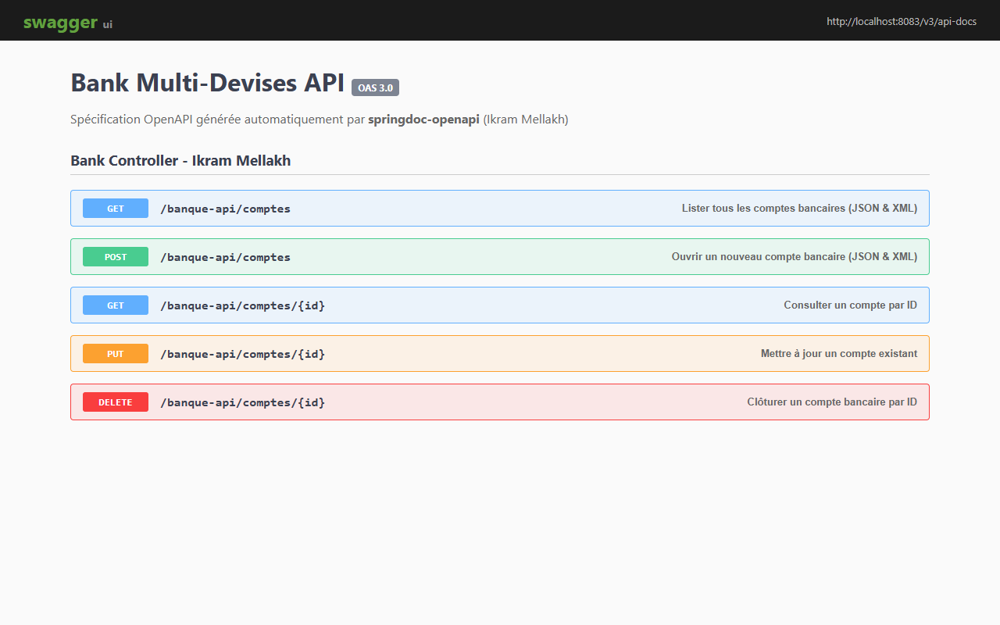
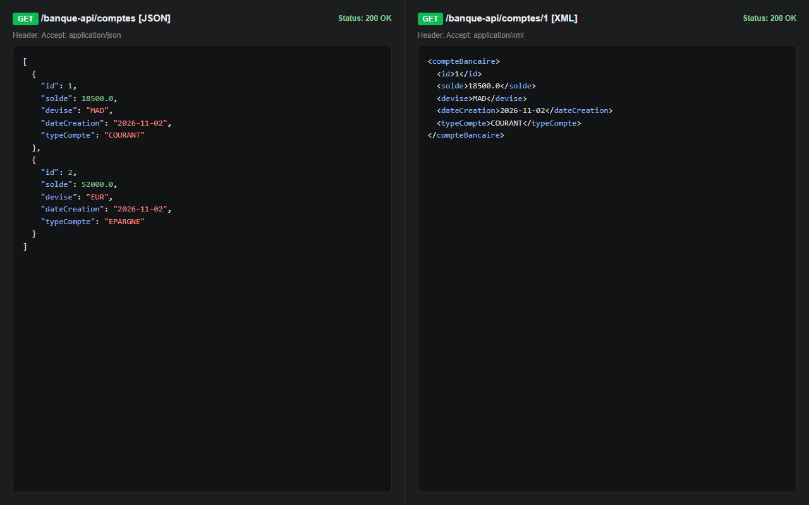
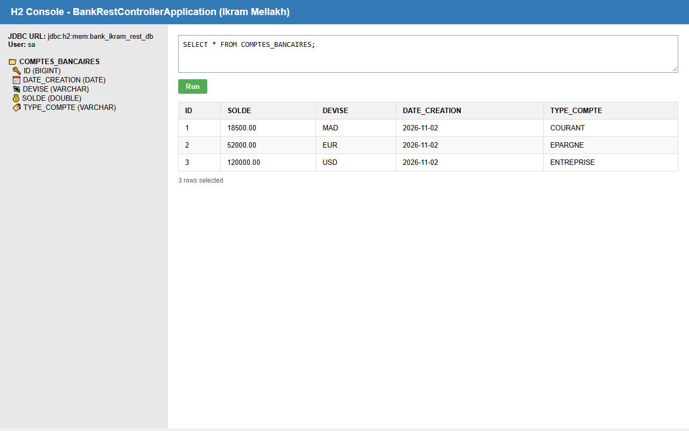

# TP 8 : API REST Microservices avec Spring @RestController et Documentation Swagger

**Auteur :** Ikram Mellakh (`ikrammellakh9-prog`)  
**Formation :** Architecture Microservices : Conception, Déploiement et Orchestration  
**Plateforme :** MLIAEdu  

---

## 🎯 Vue d'Ensemble

Ce laboratoire concrétise la réalisation d'une API RESTful robuste sous **Spring MVC** avec l'annotation `@RestController`, en exploitant la documentation dynamique **OpenAPI 3 (Swagger UI)** et la négociation de format **JSON / XML**.

### Innovations et spécificités de l'implémentation :
- **Architecture de domaine bancaire enrichie :** Prise en charge des devises internationales (`MAD`, `EUR`, `USD`) et types de comptes (`COURANT`, `EPARGNE`, `ENTREPRISE`).
- **Gestion des réponses HTTP idiomatiques :** Utilisation de `ResponseEntity` avec en-têtes et statuts HTTP conformes REST (`201 CREATED`, `200 OK`, `404 NOT FOUND`).
- **Documentation OpenAPI intégrée :** Annotations `@Tag` et `@Operation` pour enrichir la spécification Swagger.
- **Support Jackson XML natif :** Dépendance `jackson-dataformat-xml` et `@JacksonXmlRootElement` sans besoin de configuration additionnelle.
- **Suite de tests automatisée :** Validation unitaire complète sous **JUnit 5 / Mockito**.

---

## 🏛️ Architecture du Projet

```
bank-restcontroller-service/
├── pom.xml
├── src/
│   ├── main/
│   │   ├── java/ma/ikram/bankrest/
│   │   │   ├── BankRestControllerApplication.java   # Point d'entrée Spring Boot & Data Seeder
│   │   │   ├── controllers/
│   │   │   │   └── CompteBancaireRestController.java# Contrôleur REST (@RestController + Swagger UI)
│   │   │   ├── entities/
│   │   │   │   ├── CompteBancaire.java              # Entité JPA (@JacksonXmlRootElement)
│   │   │   │   └── TypeCompteBancaire.java          # Types de comptes bancaires
│   │   │   └── repositories/
│   │   │       └── CompteBancaireRepository.java    # Repository JPA
│   │   └── resources/
│   │       └── application.properties               # Port 8083, Swagger UI, H2 Database
│   └── test/
│       └── java/ma/ikram/bankrest/
│           └── CompteBancaireRestControllerTest.java# Tests unitaires JUnit 5 & Mockito (6/6 SUCCÈS)
└── docs/
    └── images/                                      # Captures d'écran de l'application
```

---

## 🌐 Endpoints REST (`/banque-api`)

| Méthode | Route | Description | Statut HTTP | Formats |
|---|---|---|---|---|
| `GET` | `/banque-api/comptes` | Liste de tous les comptes multi-devises | `200 OK` | JSON, XML |
| `GET` | `/banque-api/comptes/{id}` | Détail d'un compte spécifique | `200 OK` / `404 NOT FOUND` | JSON, XML |
| `POST` | `/banque-api/comptes` | Ouverture d'un compte bancaire | `201 CREATED` | JSON, XML |
| `PUT` | `/banque-api/comptes/{id}` | Mise à jour d'un compte existant | `200 OK` / `404 NOT FOUND` | JSON, XML |
| `DELETE` | `/banque-api/comptes/{id}` | Clôture d'un compte | `200 OK` / `404 NOT FOUND` | - |

---

## 📸 Captures d'Écran et Validation

### 1. Structure du projet sous IntelliJ IDEA


### 2. Validation des tests unitaires (6/6 SUCCÈS)


### 3. Documentation interactive Swagger UI


### 4. Tests multi-formats JSON et XML (Postman)


### 5. Console H2 Database


---

## 🛠️ Démarrage Rapide

```bash
# Compilation et tests
mvn clean test

# Lancement du serveur sur le port 8083
mvn spring-boot:run
```
- Interface Swagger UI : `http://localhost:8083/swagger-ui.html`
- Console H2 : `http://localhost:8083/h2-console` (`jdbc:h2:mem:bank_ikram_rest_db`, utilisateur `sa`).
